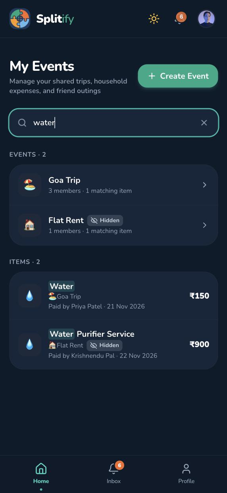
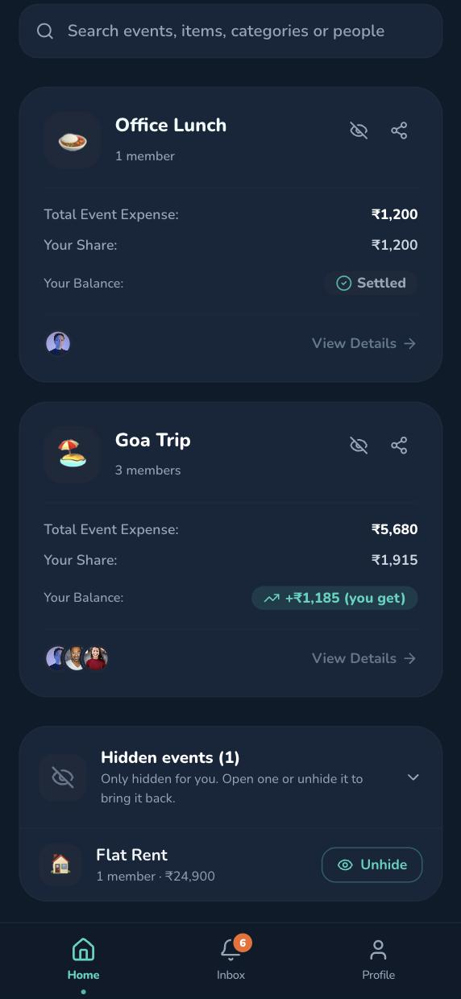
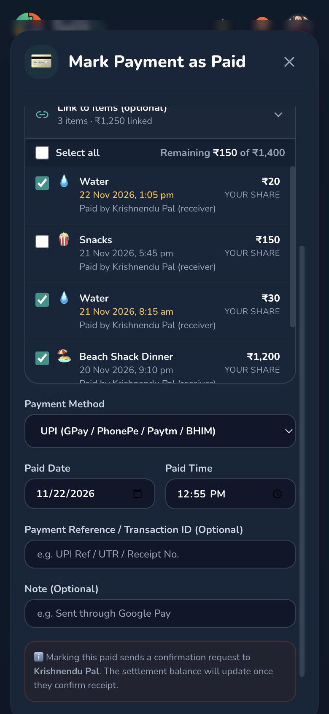
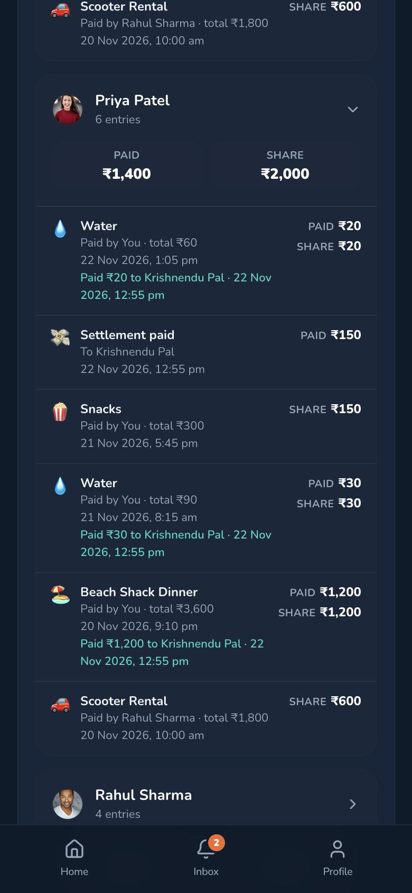
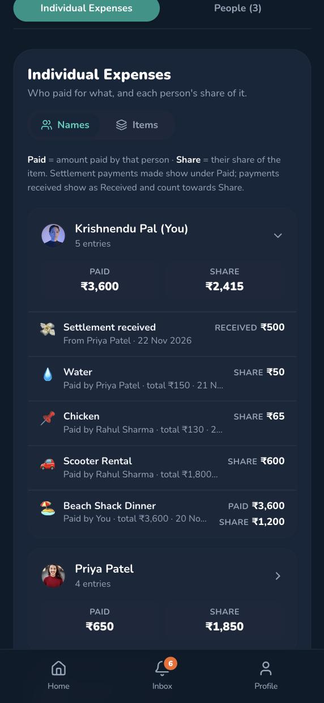
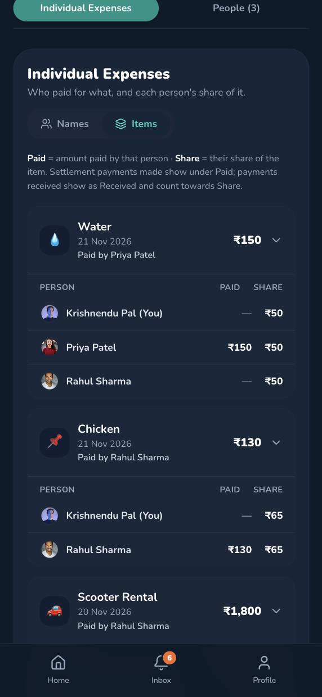
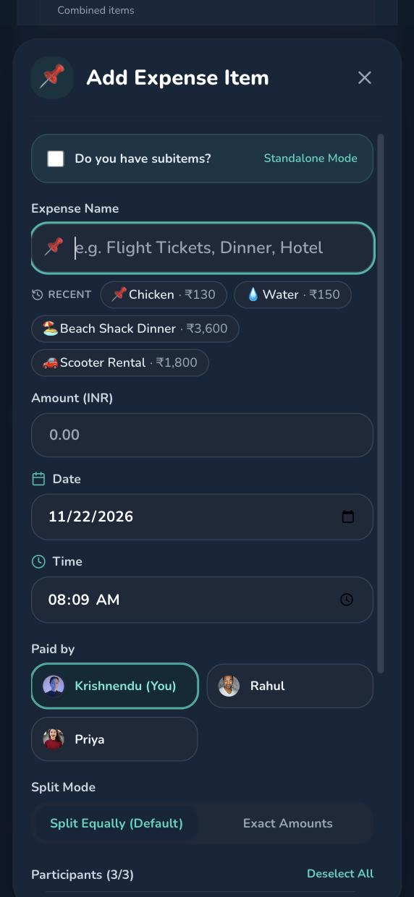
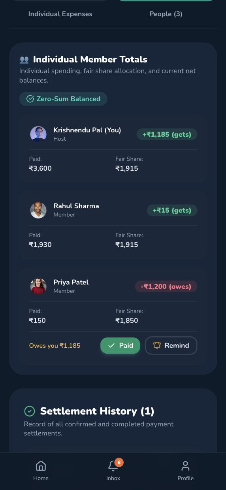

<p align="center">
  
</p>

<h1 align="center">Splitify</h1>

<p align="center">
  Shared expense tracking for trips, roommates and group outings — on the web and on Android.
</p>

<p align="center">
  <a href="https://k-692.github.io/Splitify/"></a>
  <a href="https://github.com/K-692/Splitify/raw/main/Splitify-v1.7.1.apk"></a>
</p>

---

## Screenshots

<p align="center">
  
  
</p>

<p align="center"><sub>Search events and items from Home (hidden events included) · Hidden events folder</sub></p>

<p align="center">
  
  
</p>

<p align="center"><sub>Link a payment to the items it covers · Linked amounts shown as Paid on those items</sub></p>

<p align="center">
  
  
  
  
</p>

<p align="center"><sub>Individual Expenses by name and by item · name suggestions when adding an expense · Settlements with Paid</sub></p>

## Download

| Platform | Link |
|---|---|
| Web | [k-692.github.io/Splitify](https://k-692.github.io/Splitify/) |
| Android (v1.7.1) | [Splitify-v1.7.1.apk](https://github.com/K-692/Splitify/raw/main/Splitify-v1.7.1.apk) — Android 8.0 or later |
| Release notes | [GitHub Releases](https://github.com/K-692/Splitify/releases/latest) |

**Installing the APK:** download it on your phone, open it, and allow installs from your browser or file manager if prompted. Existing installs update in place and keep your data — everything is stored in your Google account, not on the device.

## Features

**Events and expenses**
- Create an event, add expenses, and optionally group them into categories with sub-items.
- **Search from Home:** one search bar finds events and any item inside them — by item, category, note or the person who paid — including events you've hidden. Results are grouped into Events and Items, with matches highlighted; opening an item jumps to its event with the list already filtered.
- **Hide events:** hide an event to remove its card from Home. Hidden events live in a **Hidden events** folder at the bottom of Home, where they can be opened or unhidden. Hiding only affects your own view.
- Split equally, or enter exact amounts — the unassigned remainder is distributed automatically.
- **Name suggestions:** while typing an expense name, earlier names from the event and from your recent expenses appear as chips; tapping one fills the name and its last amount.
- All amounts are stored in whole paise, so totals always balance exactly.

**People**
- Add people to an event by name before they have an account. Their share is tracked from day one.
- When someone opens the invite link, they must either **select their name** from the event's list or **add themselves as a new person**. A new name that matches someone already on the list is rejected, so expenses are never split across duplicates.
- Claiming a name moves all of that person's existing expenses to their account.
- The host can remove people who have not joined yet. Removal is blocked while that person is still part of any expense, and the affected expenses are listed.

**Balances and settlements**
- **Settlements** tab: each person's total paid, fair share and net balance, with reminders for anyone who owes money.
- **Marking a payment as paid**
  - *By the person receiving the money:* recorded in the ledger immediately.
  - *By the person paying:* sent to the receiver to approve or reject before it is recorded. Only one request per payer and receiver can be open at a time, and a request is closed automatically if the receiver records the payment directly.
  - **Link to items (optional):** the person paying can tick which of their shares the payment covers, or use **Select all**. The remaining amount updates as items are ticked, and items that would exceed the amount paid can't be selected. Every item shows its date and time, so items with the same name are easy to tell apart. The receiver sees the linked items when confirming.
- **Individual Expenses** tab: every item with what each person paid and their share, grouped by **Names** or by **Items**.
  - Each item shows **Paid** (the amount that person paid) and **Share** (their share of it).
  - Payments recorded with **Paid** in Settlements appear here too: money sent shows under Paid, money received shows as Received. When a payment was linked to items, its amount appears as **Paid** on each of those items, with who it was paid to and when.
  - Each person's summary shows **Paid** (money they paid out), **Share** (their own part of items) and, when relevant, **Received** (money paid back to them). Whoever pays for an item has their own share covered by that payment — it's marked "covered" and is never shown as owed.

**General**
- Google Sign-In, real-time sync across web and Android, in-app notifications.
- **Android phone notifications:** every new in-app notification (expenses, payments, reminders, invitations) also appears in the phone's notification tray while the app is open or running in the background. Tapping it opens the event. Android 13+ asks for permission the first time. (Delivery after the app is fully closed would need Cloud Functions, which aren't on Firebase's free Spark plan, so it isn't included.)
- Pop-up forms scroll on their own and stay above the on-screen keyboard on iPhone and Android; the page behind them no longer moves.
- Light and dark themes; layouts tested down to 320 px wide.
- Plain-text expense report for sharing.

## Tech stack

| Area | Technology |
|---|---|
| App | React 19, TypeScript, Vite 6, Tailwind CSS 3 |
| Android | Capacitor 6 (min SDK 26, target SDK 34) |
| Backend | Firebase Authentication, Cloud Firestore (security rules in `firestore.rules`) |
| Tests | Vitest, React Testing Library |
| CI/CD | GitHub Actions — GitHub Pages deploy and Android build on every push to `main` |

## Project structure

```text
src/
  pages/          Home, EventDetails, Join, Notifications, Profile, Login
  components/     Shared UI, modals, and the Individual Expenses tab
  domain/         Pure balance, split and per-person ledger calculations
  services/       Firestore data access (with a local demo mode) and auth
  utils/          Currency, dates, name resolution, report export
tests/            Unit and component tests
android/          Capacitor Android project
```

## Local development

Requirements: Node.js 18+ and npm.

```bash
git clone https://github.com/K-692/Splitify.git
cd Splitify
npm install
cp .env.example .env   # add your Firebase web app config
npm run dev            # http://localhost:5173/Splitify/
```

Without Firebase credentials the app runs in a local **demo mode** backed by browser storage, which is useful for UI work.

| Command | Purpose |
|---|---|
| `npm test` | Run the test suite |
| `npm run build` | Production web build into `dist/` |
| `npm run android:sync` | Build web assets and sync them into the Android project |
| `npm run android:build` | Build a release APK |

### Android build notes

- Use **JDK 17** (the Gradle version in this project does not run on newer JDKs).
- Place your own `android/app/google-services.json` (not committed; see `google-services.json.example`).
- Release signing is read from `SPLITIFY_KEYSTORE_PATH`, `SPLITIFY_KEYSTORE_PASSWORD`, `SPLITIFY_KEY_ALIAS` and `SPLITIFY_KEY_PASSWORD`, or from `android/signing.properties` (template provided).
- Google Sign-In requires the release key's SHA-1 and SHA-256 fingerprints to be registered for `com.splitify.app` in the Firebase console.

## Deployment

Pushing to `main` runs the GitHub Actions workflows, which test and publish the web app to GitHub Pages and build the Android APK. Pushing a version tag (e.g. `v1.7.1`) publishes a GitHub Release with the APK committed at the repository root.

The backend runs entirely on Firebase's free **Spark** plan (Authentication and Cloud Firestore, no Cloud Functions). Firestore security rules are deployed with the Firebase CLI:

```bash
npx firebase-tools login
npx firebase-tools deploy --project splitify-151bd --only firestore:rules
```
